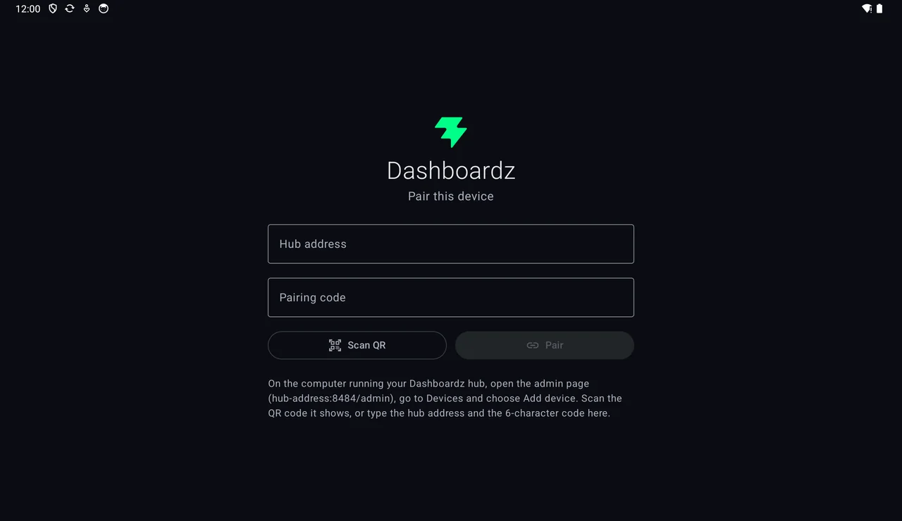
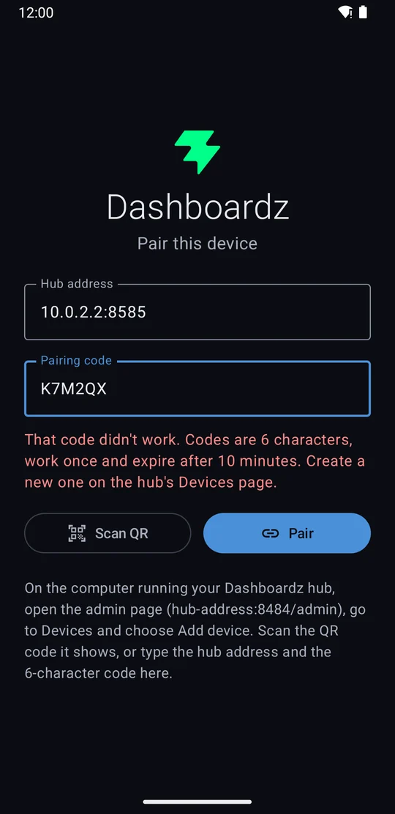
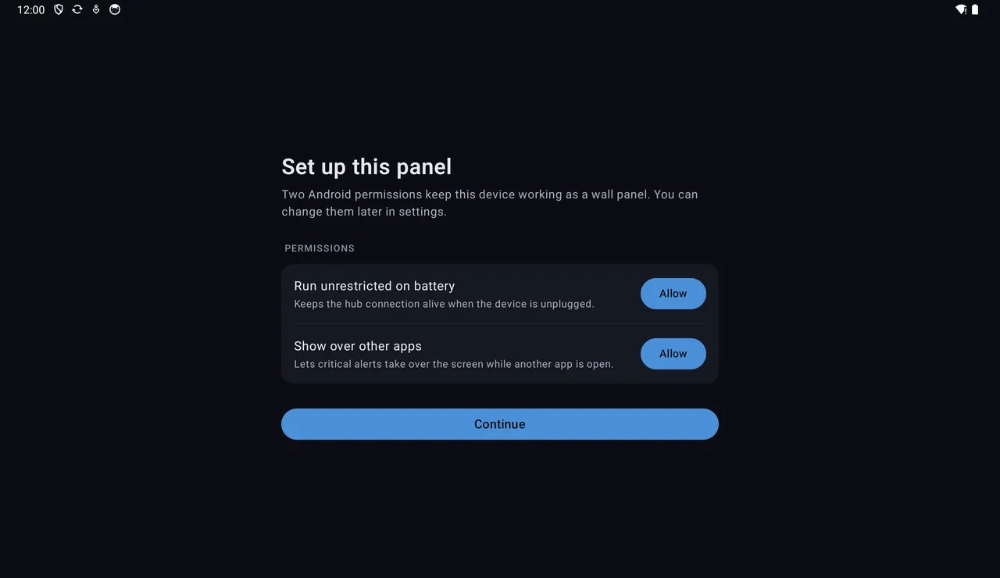
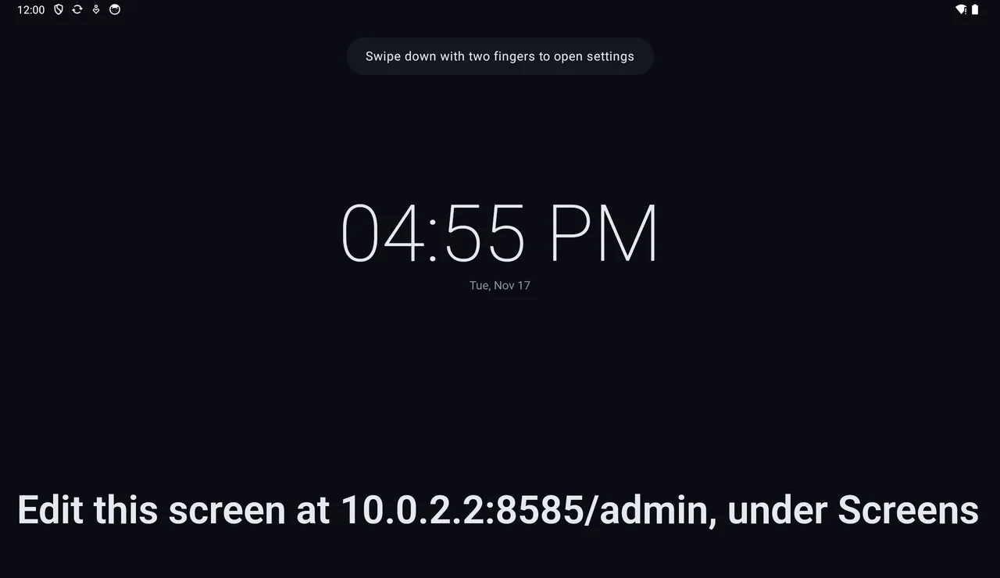
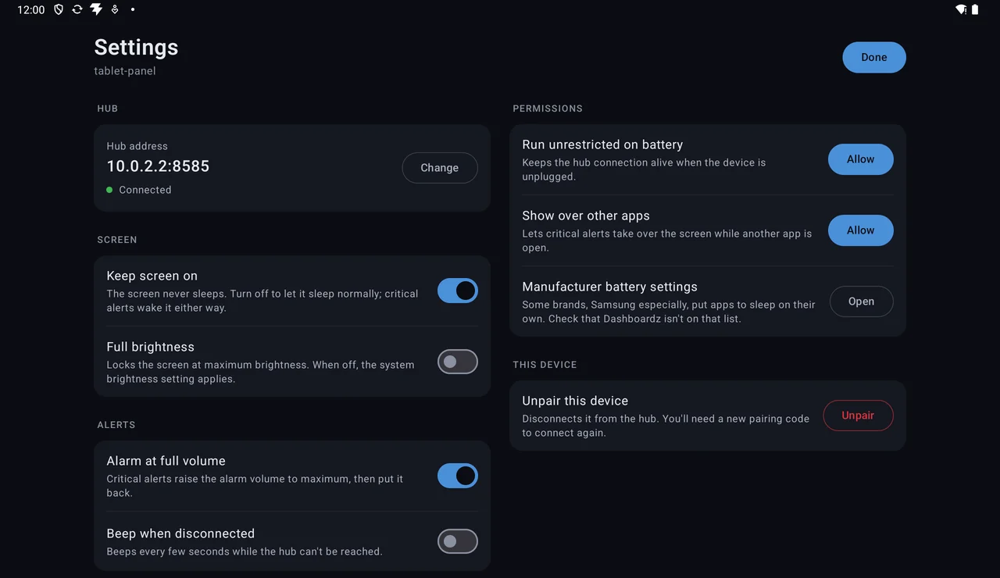
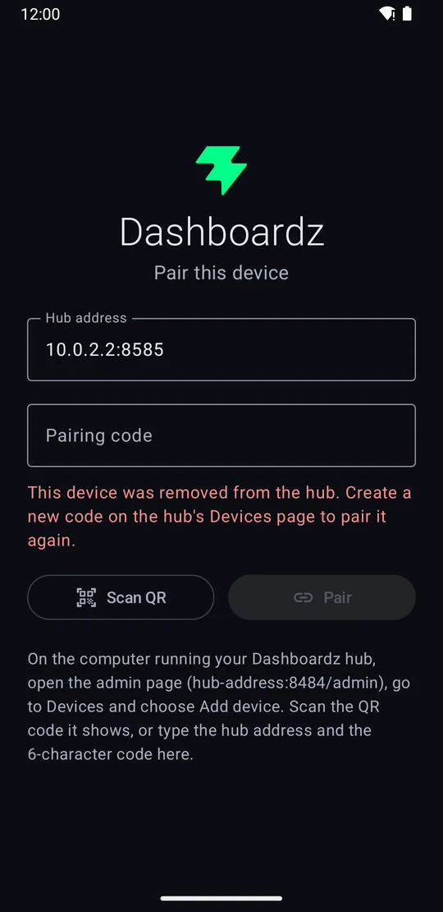

# Android app

The Android app turns a spare phone or tablet into a wall panel. It shows your
hub's screens full screen, keeps the display on, and takes over the screen with
an alarm when a critical alert arrives, even when the display is off or another
app is open. Every screen, widget and theme comes from the hub; the app itself
only handles pairing, permissions, settings and the alarm.

You need Android 6.0 or newer. Google Play services are not required.

## Install the app

Download the latest `dashboardz-<version>.apk` from the project's GitHub
releases page and open it on the device. Android asks you to allow installs
from the app you used to open it:

- **Android 8 and newer:** allow **Install unknown apps** for your browser or
  file manager when prompted.
- **Android 6 and 7:** turn on **Settings → Security → Unknown sources**.

Each release lists the APK's SHA-256 checksum. Every release is signed with the
same key, so a newer APK installs over the old one and keeps the pairing. To
check the signature on a computer, run `apksigner verify --print-certs` on the
APK; the certificate's SHA-256 digest is
`7b19d68050ed84326994490cd33d8cc222030b2bdf11cec0cd58c15181aa9a00`.

## Pair it with your hub

1. In the hub admin, open **Devices**, enter a name and choose **Add device**.
   The admin shows a six-character code and a QR code. A code works once and
   expires after 10 minutes.
2. Open Dashboardz on the device. Tap **Scan QR** and point the camera at the
   admin page, or type the hub address and the code. The address is what you
   use to reach the hub, such as `192.168.1.20:8484`; you don't need to type
   `http://`. The admin's **Devices** page shows it next to the code, and
   [Getting started](getting-started.md#find-your-computers-address) explains
   how to find it.
3. Tap **Pair**.

{ loading=lazy }

The QR code carries the hub's `PUBLIC_URL`. If the hub was started without it,
the QR code points at `localhost`, which only works on the hub's own computer.
The app says so instead of trying to connect; set `PUBLIC_URL` in the hub's
`.env` (see [Getting started](getting-started.md)), or type the hub's network
address by hand.

### If pairing fails

The app says what went wrong and what to check. For example, a code that was
already used or has expired:

{ width="300" loading=lazy }

| What happened | What to check |
| --- | --- |
| Can't reach a hub at the address | The hub is running, the address and port are right, and the device is on the same network as the hub. See [if a device can't reach the hub](getting-started.md#if-a-device-cant-reach-the-hub). |
| Can't find the name on the network | The hub's name doesn't resolve on this network. Use its IP address instead. |
| Something answered, but it isn't a Dashboardz hub | The port is wrong. The hub uses 8484 unless you changed it. |
| The code didn't work | It was used already or is older than 10 minutes. Create a new one under **Devices**. |
| Codes never contain 0, 1, I or O | The code was mistyped. Those characters are left out because they are easy to confuse. |
| Couldn't make a secure connection | Android 6.0 to 7.0 don't trust some HTTPS certificates. On your local network, use the hub's `http://` address. |

## Allow two permissions

Right after pairing, the app asks for the two Android permissions a wall panel
needs. **Allow** opens the matching Android screen; come back to the app when
you're done. **Continue** works either way, and both permissions stay
available in settings.

{ loading=lazy }

- **Run unrestricted on battery** keeps the connection to the hub alive when
  the device is unplugged. Without it, Android (Samsung devices especially)
  turns off Wi-Fi for the app and the screen stops updating.
- **Show over other apps** lets a critical alert take over the screen while
  another app is open.

## Your first screen

The hub gives every new device a starter screen: a clock, and a line saying
where to edit it. Open the hub admin, go to **Screens** and edit the screen
named after your device to add widgets, or assign other screens to the device
as tabs under **Devices**. The device updates as soon as you save.

{ loading=lazy }

The first time the screen appears, a short hint at the top explains how to open
settings.

## Settings

Swipe down with **two fingers** anywhere on the screen to open settings. One
finger is left for the screen itself, so taps and scrolling on widgets keep
working.

{ loading=lazy }

- **Hub:** the address the device connects to, and whether it is connected
  right now. Use **Change** when the hub's IP address or name changed; the
  device stays paired.
- **Screen:** keep the screen on (it never sleeps), and lock it at full
  brightness.
- **Alerts:** raise the alarm volume to maximum for critical alerts, and beep
  while the hub can't be reached.
- **Permissions:** the two permissions from setup, plus a shortcut to the
  manufacturer's own battery settings, where some brands put apps to sleep.
- **Unpair:** disconnects the device from the hub. You'll need a new code to
  pair it again.

## When something goes wrong

**The screen says it is offline.** The device can't reach the hub. The most
common cause is the hub's computer getting a new IP address from the router.
Open settings and change the hub address, or give the hub's computer a fixed
address (a DHCP reservation) on your router so it doesn't move again.

**The device went back to the pairing screen.** Someone removed it on the
hub's **Devices** page. The app says so and keeps the hub address filled in, so
pairing again only takes a new code.

{ width="300" loading=lazy }

**The app asks for a WebView update.** Dashboardz draws screens with Android
System WebView, version 80 or newer. Old phones that never received updates
may have an older one. Update **Android System WebView** from the Play Store
(on Android 7 to 9, update **Chrome** instead), then reopen Dashboardz.
