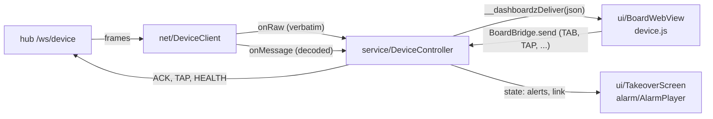

# Android app

[`apps/android`](https://github.com/rogerio-richa/dashboardz/tree/main/apps/android) is the Kotlin and Compose kiosk app that
turns a spare phone or tablet into a wall panel. It pairs, holds the
`/ws/device` socket in a foreground service, renders the board by hosting the
hub's own [board page](device-runtime.md) in a WebView, and owns the one
surface that must never fail: the full-screen critical alarm, drawn natively.
Its [README](https://github.com/rogerio-richa/dashboardz/blob/main/apps/android/README.md) covers building, settings and sound
behaviour; [Devices](../architecture/devices.md) explains the design.

All sources are under
[`app/src/main/java/com/dashboardz/device`](https://github.com/rogerio-richa/dashboardz/tree/main/apps/android/app/src/main/java/com/dashboardz/device);
paths below are relative to it.

## Start here

1. [`DashboardzApp.kt`](https://github.com/rogerio-richa/dashboardz/blob/main/apps/android/app/src/main/java/com/dashboardz/device/DashboardzApp.kt):
   `AppContainer`, the hand-rolled dependency container (OkHttp client,
   settings, controller).
2. [`service/DeviceController.kt`](https://github.com/rogerio-richa/dashboardz/blob/main/apps/android/app/src/main/java/com/dashboardz/device/service/DeviceController.kt):
   the connection lifecycle and the single state the UI renders. It reconnects
   with backoff, sends `HELLO`, ACKs and taps, forwards raw frames to the
   board, and validates everything the board sends back (`sendFromBoard`
   refuses `HELLO`).
3. [`ui/MainActivity.kt`](https://github.com/rogerio-richa/dashboardz/blob/main/apps/android/app/src/main/java/com/dashboardz/device/ui/MainActivity.kt):
   the single activity. Chooses pairing, setup checklist, board, settings or
   failure screen; applies orientation and system bars; overlays the native
   takeover on a critical.

## Layers

| Folder | What it owns |
| --- | --- |
| [`net/`](https://github.com/rogerio-richa/dashboardz/tree/main/apps/android/app/src/main/java/com/dashboardz/device/net) | `DeviceClient` (OkHttp WebSocket, close-code mapping: 4000 replaced, 4001 auth failed) and `PairApi` (`POST /api/pair`, QR and code parsing, a 20 s timeout, and typed `PairError`s the pairing screen turns into specific messages). |
| [`protocol/`](https://github.com/rogerio-richa/dashboardz/tree/main/apps/android/app/src/main/java/com/dashboardz/device/protocol) | `Wire.kt`: kotlinx.serialization mirror of [`hub/src/ws/protocol.ts`](https://github.com/rogerio-richa/dashboardz/blob/main/hub/src/ws/protocol.ts), field names in snake_case. |
| [`service/`](https://github.com/rogerio-richa/dashboardz/tree/main/apps/android/app/src/main/java/com/dashboardz/device/service) | `DeviceService` (foreground service, network callback), `DeviceController`, `HttpTransport`, `BootReceiver` (start after power loss). |
| [`core/`](https://github.com/rogerio-richa/dashboardz/tree/main/apps/android/app/src/main/java/com/dashboardz/device/core) | Pure, JVM-testable logic: `Reducer` (alert state from STATE and ALERT_* frames), `Backoff`, `Chime`, `AlarmEscalation`, `ActivityTick`, `BoardFailure`, `BoardReloadGate`, `SoundKeys`, `SwipeDown`, `Display`, `WebViewSupport` (the Chromium 80 floor the board needs). |
| [`ui/`](https://github.com/rogerio-richa/dashboardz/tree/main/apps/android/app/src/main/java/com/dashboardz/device/ui) | Compose screens (`PairingScreen`, `SetupScreen`, `SettingsScreen`, `FailureScreen`, `TakeoverScreen`, `OldWebViewScreen`), the one-time `GestureHint`, `Theme.kt` (the dark palette, contrast pinned by `ThemeContrastTest`), `BoardWebView` with its `BoardBridge`, `ScreenWaker`. |
| [`alarm/`](https://github.com/rogerio-richa/dashboardz/tree/main/apps/android/app/src/main/java/com/dashboardz/device/alarm) | `AlarmPlayer`: alarm-stream audio, ToneGenerator fallback, volume escalation. |
| [`sounds/`](https://github.com/rogerio-richa/dashboardz/tree/main/apps/android/app/src/main/java/com/dashboardz/device/sounds), [`store/`](https://github.com/rogerio-richa/dashboardz/tree/main/apps/android/app/src/main/java/com/dashboardz/device/store) | Sample download cache; persisted settings (hub URL, token, preferences). |

## How it connects

The page renders the board from the hub's JSON exactly as a browser would. The
controller also decodes every frame itself, because the native takeover and
alarm must work even if the WebView is blank, wedged or still loading.

## Things that trip people up

- **The shell owns the socket.** `BoardBridge` is installed before the page
  loads so `device.js` sees `__dashboardzHost` and never dials out; a second
  socket would be closed with 4000 and the two would loop.
- **Wire changes must stay decodable both ways.** New hub fields must be
  optional, and Kotlin fields need defaults; an unknown enum value degrades
  rather than throwing. A missing required field once dropped whole STATE
  messages on an old build.
- **There is no instrumented test harness.** No Robolectric, no emulator in
  CI. Logic that matters is pushed into `core/` so it runs on the JVM;
  Android-only shells (`SoundStore`, `AlarmPlayer`) wrap everything in
  `runCatching` and degrade to a ToneGenerator beep.
- **Board rendering in Compose is retired.** Comments that mention
  `core/Layout.kt` or a Compose board refer to code that no longer exists;
  layout rules live only in `layout-core.mjs`.

## Tests

JVM unit tests in
[`app/src/test`](https://github.com/rogerio-richa/dashboardz/tree/main/apps/android/app/src/test/java/com/dashboardz/device),
mirroring the main folders (`core/`, `net/`, `protocol/`, `service/`, `ui/`);
`CodecTest` covers wire decoding and `DeviceControllerTest` the lifecycle. Run
with `apps/android/gradlew -p apps/android test` (JDK 17).
[`acceptance.sh`](https://github.com/rogerio-richa/dashboardz/blob/main/apps/android/acceptance.sh) automates the on-device
acceptance checks against a running hub and an attached emulator or device.
