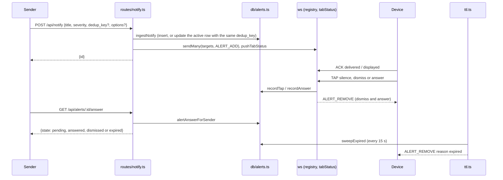

# Alerts and pairing

Two flows cross more files than any other: an alert from `POST /api/notify` to
a tap on the glass, and a device from "Add device" to its first `STATE`. This
page follows each one through the code. The behaviour is specified in
[Senders](../architecture/senders.md) and
[Devices](../architecture/devices.md).

## An alert, end to end

The files, in the order the flow reaches them:

1. [`routes/notify.ts`](https://github.com/rogerio-richa/dashboardz/blob/main/hub/src/routes/notify.ts): schema, sender-token
   auth, device-id checks, and the `resolve: true` branch that retracts an
   alert by `dedup_key`.
2. [`db/alerts.ts`](https://github.com/rogerio-richa/dashboardz/blob/main/hub/src/db/alerts.ts): the whole alert lifecycle in
   SQL. `ingestNotify` decides insert versus dedup update and computes sound
   and expiry; `recordAck`, `recordTap`, `recordAnswer` write the per-device
   `deliveries` rows; `sweepExpired`, `listActiveAlerts`, `dismissAlertById`
   serve the sweep and the admin Alerts tab.
3. [`ws/deviceSocket.ts`](https://github.com/rogerio-richa/dashboardz/blob/main/hub/src/ws/deviceSocket.ts): handles `ACK` and
   `TAP` from the device.
4. [`ws/tabStatus.ts`](https://github.com/rogerio-richa/dashboardz/blob/main/hub/src/ws/tabStatus.ts): recolours tab dots after
   every change.
5. [`ttl.ts`](https://github.com/rogerio-richa/dashboardz/blob/main/hub/src/ttl.ts): expiry, and a `timeout` outcome for an
   unanswered relayed question.
6. [`relay/handler.ts`](https://github.com/rogerio-richa/dashboardz/blob/main/hub/src/relay/handler.ts): the same ingest for a
   relayed sender, plus `emitRelayOutcome`, which sends the answer or timeout
   back over the relay (see [Relay client](hub-relay-client.md)).

On the device side, alerts are reduced by `reduce` in
[`device-core.mjs`](https://github.com/rogerio-richa/dashboardz/blob/main/hub/static/device/device-core.mjs) for the browser and
by
[`Reducer.kt`](https://github.com/rogerio-richa/dashboardz/blob/main/apps/android/app/src/main/java/com/dashboardz/device/core/Reducer.kt)
for the Android takeover.

## A device, end to end

1. The admin's **Devices** tab calls `POST /admin/api/devices/pairing-codes`
   ([`admin/senders-devices.ts`](https://github.com/rogerio-richa/dashboardz/blob/main/hub/src/routes/admin/senders-devices.ts)),
   which calls `createPairingCode` in
   [`db/devices.ts`](https://github.com/rogerio-richa/dashboardz/blob/main/hub/src/db/devices.ts): six characters from an
   alphabet without look-alikes, valid for 10 minutes.
   [`Devices.tsx`](https://github.com/rogerio-richa/dashboardz/blob/main/hub/admin/src/pages/Devices.tsx) renders it with a QR of
   `{"hub": PUBLIC_URL, "code": ...}`.
2. The device posts the code to `POST /api/pair`
   ([`routes/pair.ts`](https://github.com/rogerio-richa/dashboardz/blob/main/hub/src/routes/pair.ts)). `redeemPairingCode`
   creates the device row and its token; `seedStarterScreen`
   ([`screens/starter.ts`](https://github.com/rogerio-richa/dashboardz/blob/main/hub/src/screens/starter.ts)) gives it a starter
   screen as its first tab: a clock over a line saying where to edit it (built from
   `PUBLIC_URL`), named after the device with a numeric suffix if that name is taken. The response carries `device_token`.
3. The device opens `/ws/device` and sends `HELLO` with that token (see
   [Device socket](hub-ws.md)).
4. Revoking a device closes its socket with 4001; both clients treat 4001 as
   "unpaired" and return to the pairing surface.

Pairing clients: the browser form in
[`device.js`](https://github.com/rogerio-richa/dashboardz/blob/main/hub/static/device/device.js) (token kept in `localStorage`;
code cleanup and error wording in [`device-core.mjs`](https://github.com/rogerio-richa/dashboardz/blob/main/hub/static/device/device-core.mjs)),
and the Android
[`PairApi.kt`](https://github.com/rogerio-richa/dashboardz/blob/main/apps/android/app/src/main/java/com/dashboardz/device/net/PairApi.kt),
which also parses the QR payload.

## Things that trip people up

- **Criticals never expire.** `resolveExpiry` stores `NULL` for a critical,
  so an answerable critical never times out; it waits for a human.
- **A dedup update re-surfaces the alert.** It rewrites the active row and
  clears every delivery's `dismissed_at` and `silenced_at`, so a dismissed
  card comes back. Devices chime once per alert id, so the update itself makes
  no second sound. The reply target stays with the first requester.
- **`info` never sounds.** `resolveSound` returns 0 for `info` regardless of
  the sender's `sound` flag.
- **The answer route 404s for other senders' alerts** exactly as for unknown
  ids, so a token cannot probe which ids exist. It is not audited because it
  is a poll target.
- **The hub raises its own alerts** through the reserved `snd_hub` sender
  (schema v4): state-ack timeouts and stale feeds. That sender cannot be
  deleted.

## Tests

`notify.test.ts`, `alerts.test.ts`, `answers.test.ts`, `alertAnswer.test.ts`,
`adminAlerts.test.ts`, `ttl.test.ts`, `tabStatus.test.ts`, `pair.test.ts`,
`pairStarter.test.ts`, `devices.test.ts`, and the full HTTP plus socket path
in `e2e.test.ts`, all in [`hub/test`](https://github.com/rogerio-richa/dashboardz/tree/main/hub/test).
