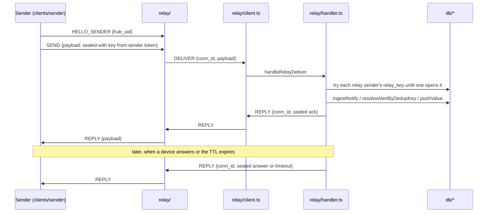

# Relay client

[`hub/src/relay`](https://github.com/rogerio-richa/dashboardz/tree/main/hub/src/relay) is the hub's outbound connection to an
optional [relay server](relay.md), for senders that cannot reach the hub
directly. The hub dials out, registers its `hub_uid`, and receives sealed
requests it decrypts and ingests exactly like a local `POST`. Design
background: [Relay](../architecture/relay.md) and
[Security model: The envelope](../architecture/security.md#the-envelope).

## Start here

1. [`bootstrap.ts`](https://github.com/rogerio-richa/dashboardz/blob/main/hub/src/relay/bootstrap.ts): `startRelay`, called from
   `boot.ts` before `listen`. Always decorates `app.relayManager`, whether or
   not a relay is configured, and wires each client's `onDeliver` to the
   handler.
2. [`manager.ts`](https://github.com/rogerio-richa/dashboardz/blob/main/hub/src/relay/manager.ts): `RelayManager`, the runtime
   configuration. Reads the relay URL and account token from the `settings`
   table (`relay_url`, `relay_token`), imports `RELAY_URL` from the
   environment once, redials on change, and reports `status()` for
   `GET /admin/api/relay`. `testRelayUrl` backs the admin's **Test** button.
3. [`handler.ts`](https://github.com/rogerio-richa/dashboardz/blob/main/hub/src/relay/handler.ts): `handleRelayDeliver`, which
   decrypts a `DELIVER` payload, applies the same limits as the HTTP routes,
   and ingests a notify, a resolve or a data push. A refused data push is
   recorded on the feed, tagged `relay`, as the HTTP route records it. `emitRelayOutcome` sends an
   answer or timeout back to the sender that asked.

## The other files

| File | What it owns |
| --- | --- |
| [`client.ts`](https://github.com/rogerio-richa/dashboardz/blob/main/hub/src/relay/client.ts) | `RelayClient`: the socket, `HELLO_HUB`, reconnect backoff, heartbeat, and the terminal close codes (4401 bad secret, 4403 token required). |
| [`envelope.ts`](https://github.com/rogerio-richa/dashboardz/blob/main/hub/src/relay/envelope.ts) | HKDF-SHA256 key derivation from the sender token and ChaCha20-Poly1305 seal/open. |
| [`identity.ts`](https://github.com/rogerio-richa/dashboardz/blob/main/hub/src/relay/identity.ts) | The hub's `hub_uid` and secret, created lazily in `relay_identity`. |

## A relayed request

## How it connects

The handler calls the same [`db/`](hub-db.md) functions as
[`routes/notify.ts`](https://github.com/rogerio-richa/dashboardz/blob/main/hub/src/routes/notify.ts) and
[`routes/feeds.ts`](https://github.com/rogerio-richa/dashboardz/blob/main/hub/src/routes/feeds.ts), then pushes through
`app.registry` and `app.dataPusher`. The device socket (an answer `TAP`) and
the TTL sweep (an expired question) call `emitRelayOutcome`. The admin badge
in [`RelayBadge.tsx`](https://github.com/rogerio-richa/dashboardz/blob/main/hub/admin/src/RelayBadge.tsx) drives
[`routes/admin/relay.ts`](https://github.com/rogerio-richa/dashboardz/blob/main/hub/src/routes/admin/relay.ts).

## Things that trip people up

- **The sender is identified by decryption.** There is no sender id in the
  frame. The handler tries each sender's stored `relay_key`; the one that
  opens the payload is the sender. An undecryptable frame gets no reply (there
  is no key to seal one with), but it is audited as `relay_undecryptable`,
  coalesced to at most one row every 5 minutes with a count, so a sender with
  a wrong token shows up on the Activity tab.
- **Relayed requests skip AJV.** They never pass through Fastify's schema, so
  `handler.ts` repeats the notify and feed limits by hand. Change both when
  you change one.
- **Relay data pushes are JSON only.** Image feeds accept only the HTTP route.
- **`envelope.ts` is forked into the sender.** It must import nothing but
  `node:crypto`; the twin is
  [`clients/sender/src/envelope.ts`](https://github.com/rogerio-richa/dashboardz/blob/main/clients/sender/src/envelope.ts), and
  both test suites share one vector.
- **Close codes are duplicated, not imported.** The hub and relay are separate
  packages; the codes in `client.ts` mirror
  [`relay/src/protocol.ts`](https://github.com/rogerio-richa/dashboardz/blob/main/relay/src/protocol.ts).
- **A reply to a dead link is dropped.** `sendReply` is a no-op unless the
  client is ready; the answer is already stored in `deliveries`.

## Tests

`relayClient.test.ts`, `relayManager.test.ts`, `relayBootstrap.test.ts`,
`relayHandler.test.ts`, `relayIdentity.test.ts`, `relayToken.test.ts`,
`relayConfigApi.test.ts`, `relayStatusApi.test.ts`, `relay-error-copy.test.ts`,
`envelope.test.ts` in [`hub/test`](https://github.com/rogerio-richa/dashboardz/tree/main/hub/test). The full three-party path
(hub, relay and sender client in one process) is
[`relay/test/e2e.test.ts`](https://github.com/rogerio-richa/dashboardz/blob/main/relay/test/e2e.test.ts).
