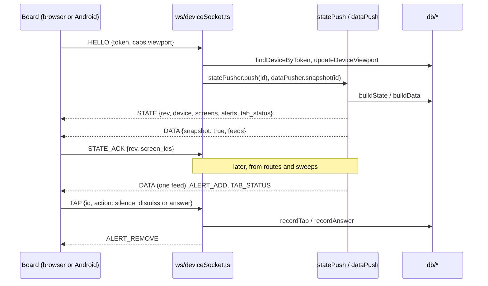

# Device socket

[`hub/src/ws`](https://github.com/rogerio-richa/dashboardz/tree/main/hub/src/ws) is the hub's side of `/ws/device`: the one
long-lived WebSocket every board holds open. The hub pushes; a device never
polls. Design background: [Hub: Push, not poll](../architecture/hub.md#push-not-poll)
and [Devices](../architecture/devices.md).

## Start here

1. [`protocol.ts`](https://github.com/rogerio-richa/dashboardz/blob/main/hub/src/ws/protocol.ts): every message type, both
   directions. Client to hub: `HELLO`, `ACK`, `STATE_ACK`, `TAB`, `TAP`,
   `HEALTH`. Hub to client: `STATE`, `ALERT_ADD`, `ALERT_REMOVE`, `DATA`,
   `TAB_STATUS`, `PLAY_SOUND`, `RELOAD`.
2. [`deviceSocket.ts`](https://github.com/rogerio-richa/dashboardz/blob/main/hub/src/ws/deviceSocket.ts): the handler. A socket
   must send `HELLO` with its device token within 5 seconds or it is closed
   (4002); a bad token closes it with 4001. After HELLO it receives a full
   `STATE` and a `DATA` snapshot. The hub pings every 30 seconds and
   terminates a socket after two missed pongs.
3. [`registry.ts`](https://github.com/rogerio-richa/dashboardz/blob/main/hub/src/ws/registry.ts): `DeviceRegistry`, a map of
   device id to socket. A second socket for the same device closes the first
   with 4000 `replaced`.

## The pushers

| File | Message | Behaviour |
| --- | --- | --- |
| [`statePush.ts`](https://github.com/rogerio-richa/dashboardz/blob/main/hub/src/ws/statePush.ts) | `STATE` | Per-device revision. Expects a `STATE_ACK`; on timeout it raises a warn alert on the *other* devices through the reserved `snd_hub` sender. |
| [`stateBuilder.ts`](https://github.com/rogerio-richa/dashboardz/blob/main/hub/src/ws/stateBuilder.ts) | builds `STATE` | Device, tabs (each a screen with grid, theme reference and resolved sounds), active alerts, tab dots. |
| [`dataPush.ts`](https://github.com/rogerio-richa/dashboardz/blob/main/hub/src/ws/dataPush.ts) | `DATA` | Fire and forget. `snapshot` on connect, `onFeedPush` after each write, `snapshotReferencing` after a feed is edited or deleted. Only devices whose tabs reference the feed receive it. |
| [`tabStatus.ts`](https://github.com/rogerio-richa/dashboardz/blob/main/hub/src/ws/tabStatus.ts) | `TAB_STATUS` | The severity dot per tab, recomputed and broadcast after any alert change. |
| [`feedStale.ts`](https://github.com/rogerio-richa/dashboardz/blob/main/hub/src/ws/feedStale.ts) | `ALERT_ADD` | Timer that raises one warn alert per feed when a feed with `alert_on_stale` goes stale. |

## How it connects

Routes and sweeps never touch sockets directly; they call `app.registry`,
`app.statePusher`, `app.dataPusher` or `pushTabStatus`. A `TAP` with
`action: 'answer'` also calls `emitRelayOutcome` from
[`relay/handler.ts`](https://github.com/rogerio-richa/dashboardz/blob/main/hub/src/relay/handler.ts) so a relayed sender hears
the answer (see [Alerts and pairing](hub-alerts-pairing.md)).

## Things that trip people up

- **Nothing a client sends may throw.** Every message is parsed inside one
  `try`; malformed frames are dropped silently. Keep new message handling
  inside it.
- **STATE state is memory only.** Revisions and ack tracking reset on
  reconnect by design; a reconnecting device simply gets a fresh STATE.
- **The stale socket's `close` fires after the new one attached.** That is
  why `close` only drops the pusher entry when the registry says the device is
  offline.
- **Wire fields are additive.** Older Android builds decode with
  `ignoreUnknownKeys` and break on a missing required field, so new fields
  are optional and `theme` is omitted (never `null`) when a screen has none.
  The Kotlin mirror is
  [`Wire.kt`](https://github.com/rogerio-richa/dashboardz/blob/main/apps/android/app/src/main/java/com/dashboardz/device/protocol/Wire.kt).
- **Tabs are the only screen assignment.** Since v25 the `device_screens`
  table is the single truth; there is no legacy `screen_id` column.

## Tests

`ws.test.ts` (socket lifecycle), `statePush.test.ts`, `stateBuilder.test.ts`,
`stateAckTabs.test.ts`, `stateTabs.test.ts`, `dataPush.test.ts`,
`tabStatus.test.ts`, `feedStale.test.ts`, `deviceReload.test.ts`,
`playSound.test.ts` in [`hub/test`](https://github.com/rogerio-richa/dashboardz/tree/main/hub/test).
