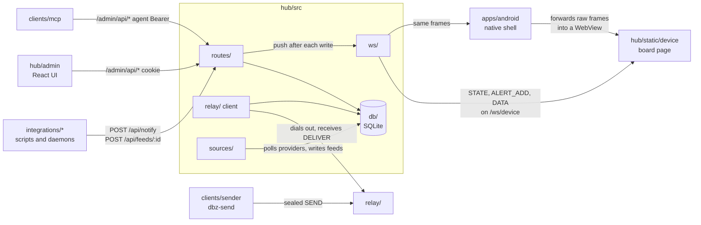

# Reading the code

These pages are a map of the source tree: what each part does, which file to
open first, and how the parts talk to each other. They answer "where is it in
the code and how do I read it". For *why* the system is shaped this way, read
the [architecture pages](../architecture/overview.md); for setup and the
commands that verify a change, read the [development guide](../development.md).

Every page follows the same outline: what the section is for, where to start
reading, how it connects to the rest, the things that trip people up, and
where its tests live. Code links point at `main` on GitHub.

## How the parts connect

The hub is the only process that writes state. Everything on the left reaches
it over HTTP, either directly or sealed through the relay. Everything on the
right is a renderer: the browser board page draws every screen, and the Android
app is a shell that owns the socket and hosts that same page.

## Reading order

Read top to bottom the first time. Each line is the page's one-sentence
summary.

**The hub server (`hub/src`)**

1. [Hub core and boot](hub-core.md): process entry, boot order, Fastify wiring, config, auth and secret helpers.
2. [Database and migrations](hub-db.md): the SQLite schema, the append-only migration list, and the query modules every route calls.
3. [HTTP routes](hub-routes.md): every endpoint, which credential guards it, and where admin routes are split.
4. [Device socket](hub-ws.md): the `/ws/device` protocol, the STATE, DATA and TAB_STATUS pushers, and the stale-feed sweep.
5. [Alerts and pairing](hub-alerts-pairing.md): one alert and one device followed through every file they touch.
6. [Screens and widget contracts](hub-screens.md): how a screen save is validated, and the server-side widget, contract and capability rules.
7. [Data sources](hub-sources.md): the scheduled providers that fill feeds, drafts, and output writing.
8. [Relay client](hub-relay-client.md): how the hub dials a relay, decrypts relayed requests, and replies.

**What the hub serves**

9. [Admin UI](hub-admin.md): the React control panel in `hub/admin`.
10. [Board runtime](device-runtime.md): `device.js` and the pure modules that render a board in a browser.
11. [Widget designs](widgets.md): the canvas designs, the catalogue, and the shared widget plumbing.
12. [Theme packs](packs.md): the shared pack checker in `hub/packs/`, the `check-pack` command and the example pack.
13. [Hub tests](hub-tests.md): how `hub/test` is organised, including the tests that pin docs and duplicated constants.

**Other components**

14. [Android app](android.md): the Kotlin kiosk shell, its controller, and the native takeover.
15. [Relay server](relay.md): the WebSocket switchboard in `relay/`.
16. [MCP server](mcp.md): `clients/mcp`, agent tools over the admin API.
17. [Sender client](sender.md): `clients/sender` and the `dbz-send` CLI, plus the OpenClaw skill.
18. [Claude integration](integration-claude.md): the ask skill, wall hooks, and the assistant daemon.
19. [Netdata integration](integration-netdata.md): shell pipeline from Netdata alarms and `/proc` to the hub.
20. [Meshtastic integration](integration-meshtastic.md): Python daemon that turns radio traffic into feeds and alerts.
21. [Scripts and CI](scripts.md): repository scripts, hub helper scripts, and the CI workflow.

## Keeping these pages true

A change that adds, moves, renames or changes the responsibility of code in a
section updates that section's page in the same change. `node
scripts/check-code-docs.mjs` (also run by `scripts/check-all.sh` and by the hub
test suite) fails when a code link points at a path that no longer exists, when
a code section has no page linking into it, or when a page is missing from this
index or the MkDocs nav. See [Scripts and CI](scripts.md) for how it works.
