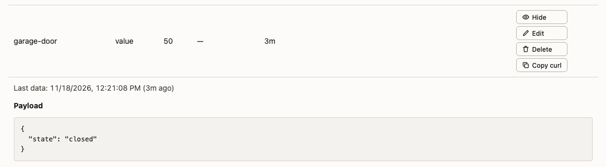
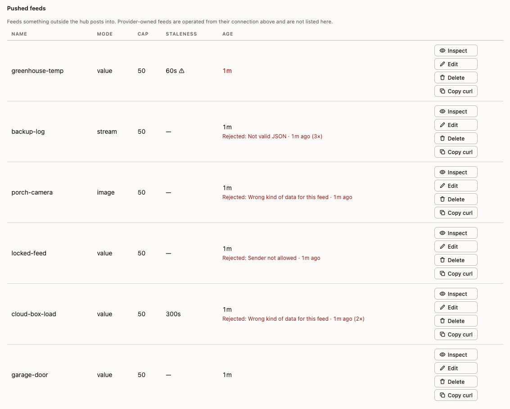
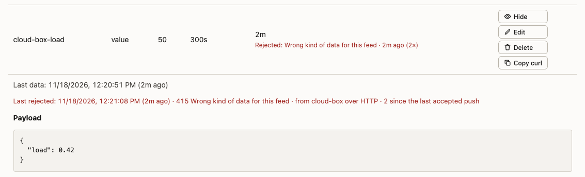
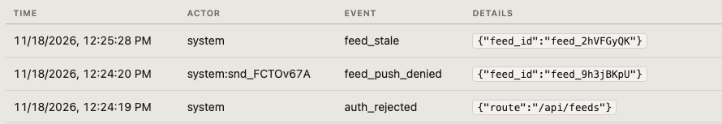
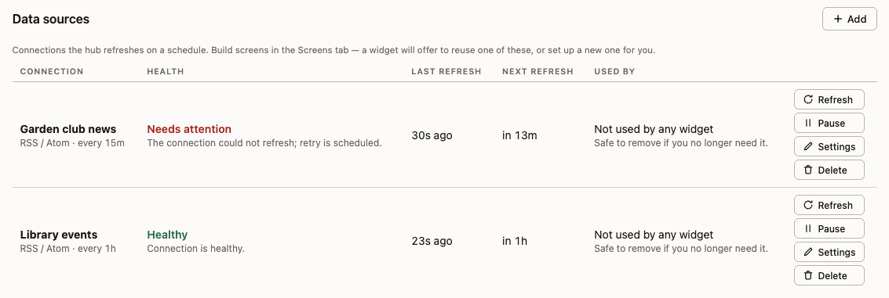
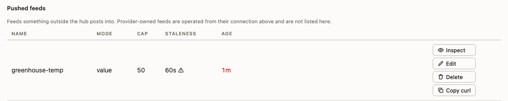

# Getting data onto screens

Every widget on a screen shows data from a **feed**: a named slot on the hub
that holds the latest value, a rolling list of rows, or one image. This page
is the map: the ways data gets into feeds, how to pick one, what each accepts,
how to check it worked, and where to look when it didn't.

## Two ways in

Data reaches a feed by one of two routes, and they suit different jobs.

- **The hub fetches it.** You set up a **data source** and the hub polls it
  on a schedule. There are three kinds, built in: weather (Open-Meteo),
  calendars (any iCalendar link) and news (any RSS or Atom feed). Nothing
  runs outside the hub.
- **Something pushes it.** A script, a monitoring tool or an agent sends data
  to a feed whenever it has some, authenticated by a **sender token**.
  Anything you can measure or compute yourself takes this route.

| Path | What it's for | Set up in | Feeds the widgets |
|---|---|---|---|
| **Data source** | Weather, calendars, news headlines | Screen editor (**Add weather**, **Add a calendar**) or **Data sources › Add** | Five-day forecast, Calendar, News list |
| **HTTP push** (`POST /api/feeds/:id`) | Anything on your network that can run `curl`: cron jobs, home automation, scripts | **Data sources › Add › Advanced: push data yourself**, plus a sender on **Senders** | Value, Gauge, Stream list, Table, Text, Chart, Image |
| **`dbz-send` over the relay** | A pusher with no route to your hub: a cloud box, another network | Same feed and sender, plus a relay on the hub ([remote access](remote-access.md)) | Same as HTTP push, except Image |
| **An agent through `dashboardz-mcp`** | An AI agent creating feeds and senders for you | An agent token on **Agents** ([MCP server](code/mcp.md)) | Whatever it then pushes over HTTP |
| **A ready-made integration** | Netdata, Meshtastic radios, Claude | Follow its gallery page | Its own feeds and alerts ([gallery](gallery/index.md)) |

Clock and Alerts widgets need no data at all.

**Choosing.** If what you want is weather, a calendar or headlines, use a
data source: those three widgets only accept data from one (see
[Screens](architecture/screens.md#semantic-widgets-weather_forecast-news_list-calendar_events)),
and the hub does the polling for you. For anything else, push. Push over
HTTP when the pusher can reach the hub, over the relay when it can't.

## What a feed accepts

A pushed feed has one of three **modes**, chosen when it is created and fixed
after that:

| Mode | Each push | Body | Limit |
|---|---|---|---|
| **value** | Replaces the current value | Any JSON, with `content-type: application/json` | 16 KB |
| **stream** | Appends a row; the oldest fall off past the feed's cap (50 by default, 500 at most) | Any JSON, with `content-type: application/json` | 16 KB per push |
| **image** | Replaces the current image | Raw PNG, JPEG or static WebP bytes, with a matching `content-type` | 512 KB and 2048×2048 pixels |

The hub does not prescribe a JSON shape. A widget is told which field to read
(its *path*), so `{"value": 21.5}` and `{"cpu": {"temp": 61}}` are both fine;
the [binding summary](architecture/screens.md#the-binding-summary) lists what
each widget needs at the end of its path. Data sources are different: they
write fixed, versioned shapes called contracts, described in
[Data sources](architecture/data.md#contracts), and only a source can fill a
contract feed.

Over the relay, the same JSON limit applies and image feeds are not supported.

## Setting up a push, end to end

1. **Senders › Add.** Name it after what will push (`greenhouse`). Copy the
   token now: it is shown once.
2. **Data sources › Add › Advanced: push data yourself.** Name the feed, pick
   its mode, and optionally set **Stale after** and **Alert on stale** (see
   [staleness](#staleness-and-dead-man-alerts)) and **Allowed senders**.
3. **Push.** The feed's **Copy curl** button gives a working command for its
   mode; replace `YOUR_SENDER_TOKEN` with the token.
4. **Bind it.** In **Screens**, add a widget and pick the feed.
5. **Check it.** See the next section.

[Building an integration](integrations.md) walks through the same steps with
every command and response.

## Checking that it worked

On **Data sources**, under **Pushed feeds**:

- **Age** says how long ago the last accepted push arrived. It turns red when
  the feed is past its **Stale after** limit, and reads `never` (grey) until
  the first push.
- **Inspect** opens the feed. **Last data** gives the exact date and time of
  the last accepted push, followed by the current payload and, for a stream,
  the newest 20 rows. It refreshes every 5 seconds while open, so you can
  push and watch it change.

A healthy feed: **Inspect** shows when the last push arrived and what it carried.

A successful push also answers the pusher with `{"ok": true, "pushed_at": ...}`.

## When a push fails

A refused push is answered with an HTTP error, and since hub v28 it also
leaves a mark on the feed. Where to look:

| Where | What you see | For |
|---|---|---|
| **The pusher's own output** | The HTTP status and `{"error": "..."}` (tables below) | Every failure |
| **Data sources › Pushed feeds**, the feed's row | `Rejected: <reason> · <when> (<count>×)` in red, while the rejection is newer than the last accepted push | A known sender pushing to an existing feed |
| **Inspect** | `Last rejected:` date and time, status, reason, which sender, HTTP or relay, and how many since the last accepted push | Same, kept after a later push succeeds |
| **Activity** | `auth_rejected` (bad token), `feed_push_denied` (sender not allowed), `relay_undecryptable` (see the relay table), `feed_stale` | Failures that are about who is pushing |
| **Data sources**, a data source's row | **Healthy**, **Needs attention** or **Paused**, with a sentence saying what went wrong | Hub-fetched sources |

A bad token is never recorded on the feed: until the hub knows who is
pushing, it does not let the caller write anything.

On **Pushed feeds**, a feed whose latest push was refused says so under its Age, with a short reason, when it happened and how many times.

**Inspect** gives the full record of the last refusal. The payload is still the one from the last accepted push: a refused push changes nothing.

**Activity** records the failures about who is pushing: a bad token (`auth_rejected`), a sender the feed doesn't allow (`feed_push_denied`), and feeds going stale (`feed_stale`).

A data source that failed its last refresh reads **Needs attention**, with a sentence saying what happened.

### HTTP errors

Every error body is `{"error": "<message>"}`. The hub checks the token, the
feed and the sender's permission before it reads the body, so those three
come first.

| Status | `error` | Cause | Recorded on the feed |
|---|---|---|---|
| 401 | `invalid token` | Missing, wrong or deleted sender token | No (Activity: `auth_rejected`) |
| 404 | `unknown feed` | Wrong feed id, or the feed was deleted | No |
| 403 | `sender not allowed` | The feed's **Allowed senders** doesn't include this sender. Feeds a data source owns accept no senders at all | Yes, and Activity: `feed_push_denied` |
| 400 | `no body: send the JSON payload with content-type: application/json` | Empty body, or a body with no `content-type` header | Yes |
| 400 | `body is not valid JSON` | The JSON doesn't parse | Yes |
| 415 | `this feed takes JSON: send it with content-type: application/json` | Wrong content type on a value or stream feed. `curl -d` without `-H "content-type: application/json"` sends form data and lands here | Yes |
| 415 | `this is a value feed: it takes JSON, not an image` | Image bytes sent to a value or stream feed | Yes |
| 413 | `body is larger than the 16 KB limit for JSON pushes` | JSON over 16 KB | Yes |
| 400 | `this is an image feed: push PNG, JPEG or static WebP bytes, not JSON` | JSON sent to an image feed | Yes |
| 415 | `this is an image feed: send PNG, JPEG or static WebP bytes with a matching content-type` | Some other content type on an image feed | Yes |
| 415 | `PNG, JPEG or static WebP only` | The bytes aren't one of those formats, don't match the declared `content-type`, or are an animated WebP | Yes |
| 413 | `image is larger than the 512 KB limit` | Image over 512 KB | Yes |
| 400 | `image exceeds 2048x2048` | Image dimensions too large | Yes |

### Relay errors

`dbz-send` prints these. Rejections the hub sends back arrive sealed, like
every reply; the relay's own errors come from the relay.

| Message | From | Cause | Recorded on the feed |
|---|---|---|---|
| `feed_id is required`, `feed_id must be at most 64 chars` | Hub | Malformed request | No |
| `unknown feed` | Hub | Wrong feed id | No |
| `sender not allowed` | Hub | As over HTTP | Yes, and Activity: `feed_push_denied` |
| `payload is required` | Hub | No payload | Yes |
| `payload too large` | Hub | JSON over 16 KB | Yes |
| `image push not supported over relay` | Hub | Image feeds take HTTP only | Yes |
| `hub_offline` | Relay | The hub isn't connected to the relay right now | No |
| `rate_limited` | Relay | Over the relay's per-hub budget (120 messages a minute by default, shared by all of a hub's senders); the message is dropped, not queued | No |
| `no ack from the hub within ...ms` | `dbz-send` | The hub is online but couldn't open the message: almost always a wrong or revoked token, or a sender created before relay support. The hub can't reply to a message it can't open | No (Activity: `relay_undecryptable`, at most one row every 5 minutes, with a count) |

## Staleness and dead-man alerts

A feed fed on a schedule should say when its pusher stops. Two settings do
that:

- **Stale after** (`stale_after_s`, at least 5 seconds): how long the feed
  may go without an accepted push before it counts as stale. Widgets on a
  stale feed show it, and the Age column turns red.
- **Alert on stale** (`alert_on_stale`): when the feed goes stale, raise an
  alert.

How the alert behaves:

- The hub checks every 60 seconds.
- It raises one silent warning per crossing from fresh to stale, titled
  `Feed "<name>" has gone stale`, on every device. It expires after an hour,
  and Activity records `feed_stale`.
- When pushes resume, the feed is fresh again, but the alert is not
  withdrawn; it simply expires.
- **A feed that has never been pushed is not stale and never alerts.** The
  devices, the admin and the alert all follow that rule, so a pusher that
  never starts goes unnoticed. Check **Age** after setting one up.

Feeds a data source owns get both settings automatically: stale after three
of the source's polling intervals, with the alert on.

## Allowed senders

By default any sender with a valid token can push to any pushed feed. A
feed's **Allowed senders** narrows that to the senders you tick; leave it
empty to accept any. Over the admin API and the MCP, `allowed_senders: null`
means any sender and `[]` means nobody. Ids aren't checked, so a mistyped id
locks every sender out. A push from a sender not on the list is refused with
`403 sender not allowed`.
