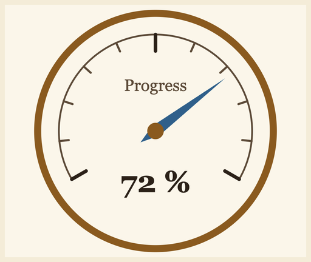
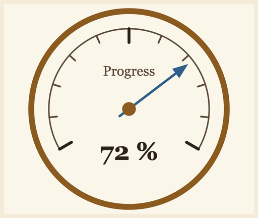
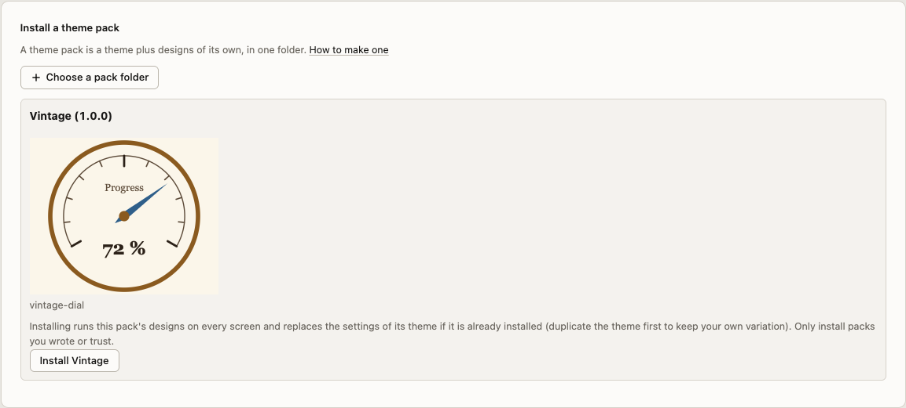
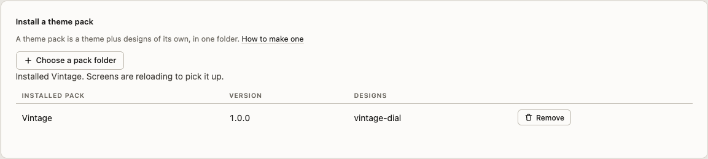

# Make a theme pack

A **theme pack** is a theme plus any designs it draws itself, in one folder:
a palette, a backdrop, sounds, which design each widget uses by default and
which others it suggests, and new designs for any widget. This page is a
recipe you, or an AI working for you, can follow from start to finish. The
worked example lives in the repository at
[`examples/theme-packs/vintage`](https://github.com/rogerio-richa/dashboardz/tree/main/examples/theme-packs/vintage).



You need Node 22 or newer and a copy of the Dashboardz repository. The
checker needs nothing else; its previews also need Google Chrome or Chromium.

## What's in a pack

```
vintage/
  pack.json                          the theme and the pack's identity
  designs/
    gauge/vintage-dial.mjs           one file per design: designs/<widget>/<design id>.mjs
```

A pack can have no designs at all and only pick from the built-in ones, or
bring as many as it likes. A pack can't add new widget *types*: its designs
draw the widgets the hub already has (`clock`, `gauge`, `value_tile`,
`table`, `chart` and so on), in a new way and with settings of their own.

## `pack.json`

```json
{
  "id": "vintage",
  "name": "Vintage",
  "version": "1.0.0",
  "description": "Warm paper and brass: an analog clock, a brass dial gauge, soft bells.",
  "theme": {
    "board": {
      "bg": "#f4ecd8", "surface": "#fbf6ea", "ink": "#2b2118", "dim": "#5c4a38",
      "accent": "#8a5a1f", "info": "#2f5f8a", "warn": "#8a5a06", "critical": "#a32b25",
      "scrim": 0.4, "series": ["#8a5a1f", "#2f5f8a", "#5f7a2a", "#a32b25"]
    },
    "backdrop": "wash",
    "widgets": { "clock": "analog", "gauge": "vintage-dial" },
    "recommended": { "clock": ["flip"], "gauge": ["ring"] },
    "sounds": { "critical": "bells", "warn": "bells", "info": "bells", "offline": "bells", "activity": "bells" }
  }
}
```

| Field | What it is |
|---|---|
| `id` | The pack's short name: 2 to 32 lowercase letters, digits and dashes, starting with a letter. Every design in the pack has an id starting with it, like `vintage-dial`, so packs never clash with each other or with built-in designs. |
| `name` | The theme's display name. |
| `version` | Like `1.0.0`. |
| `description`, `author` | Optional. |
| `theme.board` | The palette, all ten entries: `bg` (background), `surface` (cards), `ink` (text), `dim` (secondary text), `accent`, the alert colours `info`, `warn`, `critical`, `scrim` (0 to 1, how dark the overlay behind a critical alert is) and `series` (4 chart colours). Colours are `#rgb` or `#rrggbb`. What each one is used for is in [Theming](theming.md#the-palette). |
| `theme.backdrop` | One of `flat`, `wash`, `glow`, `cards`, `grid`. |
| `theme.widgets` | The design each widget uses by default under this theme. Built-in design ids or your own. |
| `theme.recommended` | Other designs that suit the theme, per widget. The screen editor lists them first. Don't repeat the default here. |
| `theme.sounds` | Optional: a sound family per alert event (`critical`, `warn`, `info`, `offline`, `activity`). |

Text must be readable: `ink` needs a contrast of at least 4.5:1 against `bg`
and `surface`, and the other colours at least 3:1. The checker measures this.

## Writing a design

A design is one JavaScript file that exports `{ meta, draw }`. The full
contract is in [Widgets](architecture/widgets.md); these are the rules a pack
design must follow:

- **One file, no imports.** Copy any small helper you need into the file.
  That keeps a pack design checkable and installable on its own.
- **`meta`** names the design (`id`, `widget`, `label`), its shape
  (`suggested_ratio`, width divided by height), the colours it paints
  (`tokens`, usually pointing at palette entries like `"@accent"`), its
  settings (`options`) and `animations` (`{ transition: [], persistent: [] }`
  for a still design).
- **`draw(g, ctx)`** paints one frame. `g` is a canvas limited to the
  [portable drawing subset](architecture/widgets.md#the-portable-drawing-subset)
  (lines, arcs, fills, text, transforms; no gradients or images from the
  network). `ctx` carries the colours (`ctx.tokens`), the card's size
  (`ctx.box`), the cell's settings (`ctx.config`), the data (`ctx.data`), the
  time (`ctx.now`) and whether the data is stale (`ctx.stale`).
- **Paint every colour you declare.** A token in `meta.tokens` that's never
  used to paint can't be themed, so the checker treats it as a mistake.
- **Draw something sensible for any data**: no data yet, an empty value, stale
  data, a tiny card or a huge one. The checker tries each.

### Settings of your own

A design can use the settings its widget already has (a gauge has `label`,
`unit`, `min`, `max`, `decimals`, `thresholds.warn`, `thresholds.crit`) and
add its own. Its own settings live under **`design_options`**, which the hub
stores for any widget without needing to know about your design:

```js
needle: { type: 'select', label: 'Needle', default: 'spade', choices: ['spade', 'arrow'], path: 'design_options.needle' },
```

The screen editor shows the field automatically. Read it defensively, so a
missing or wrong value falls back to your default:

```js
const needleStyle = ctx.config?.design_options?.needle === 'arrow' ? 'arrow' : 'spade'
```

`design_options` holds at most 32 settings, named with lowercase letters,
digits and underscores; each value is a number, true/false, text up to 200
characters, or a list of up to 16 of those; 2 KB in all.



## Check it

From the repository root:

```bash
node hub/scripts/check-pack.mjs path/to/your-pack --previews /tmp/your-pack-previews
```

It prints every problem it finds, grouped by file, with what to do about it,
and exits with 1 if there are errors (0 means the pack is good; warnings are
allowed). With `--previews` it also draws each design to a PNG with your
palette and sample data, one more per choice of each of your own select
settings. That needs Chrome or Chromium; set `CHROME_PATH` to use a specific
one. Without a browser it still checks everything and says previews were
skipped.

This is what it says about a copy of the example with three mistakes in it:
text too pale for the background, a setting outside `design_options`, and a
colour declared but never painted.

```text
pack.json
  error    Text (ink) on the background (bg): #c9b99a on #f4ecd8 has contrast 1.64:1, below the 4.5:1 needed to read it. Make one of them lighter or darker. (theme.board)
  error    Text (ink) on cards (surface): #c9b99a on #fbf6ea has contrast 1.79:1, below the 4.5:1 needed to read it. Make one of them lighter or darker. (theme.board)

designs/gauge/vintage-dial.mjs
  error    Setting "needle": it saves to "needle", which a gauge doesn't have, so saving a screen with this design would fail. Put a design's own settings under design_options: use path "design_options.needle".
  error    Colour "glass" is declared in meta.tokens but never painted, in any sample. Paint with it (g.fillStyle or g.strokeStyle = ctx.tokens.glass) or remove it.

4 errors, 0 warnings
```

Fix, run it again, and repeat until it says `No problems found.` Look at the
previews too: the checker can't tell whether a design looks right, only
whether it follows the rules. (For example, it doesn't notice a dial drawn
larger than its card.)

### Common problems and what to do

| The checker says | What to do |
|---|---|
| "... has contrast 1.6:1, below the 4.5:1 needed" | Make the two colours further apart: darker text or a lighter background. |
| "Setting ... saves to ..., which a gauge doesn't have" | Give the setting a `path` under `design_options.`, as the message suggests. |
| "Setting ...: the hub only accepts ... for ..." | Use only the values that widget accepts, or make it your own setting under `design_options.`. |
| "Colour ... is declared in meta.tokens but never painted" | Paint with it (`g.fillStyle = ctx.tokens.<name>`) or remove it from `meta.tokens`. |
| "draw crashes with ..." | Read each value with a fallback (`typeof x === 'number' ? x : 0`); the message says which case failed. |
| "A pack design must be one file with no imports" | Copy the helper you imported into the design file. |
| "Uses drawing calls outside what every screen supports" | Use only the calls in the [portable drawing subset](architecture/widgets.md#the-portable-drawing-subset). |
| "... is not a theme setting (a typo?)" | Check the spelling against the `pack.json` table above. |

The checker runs the same rules the hub's own tests hold the built-in themes
and designs to. It's a quality check, **not a security boundary**: checking a
pack runs its designs as programs on your computer, with your permissions,
and installing it runs them on every screen. Only check and install packs you
wrote yourself or trust.

## Install it

On a hub you run yourself, install a pack from the admin: **Themes**, then
**Install a theme pack**, **Choose a pack folder**, and pick the pack's
folder (the one with `pack.json` in it). The hub runs the same checks as the
command line. If anything is wrong you see the list and nothing is installed;
if not, you see a preview of each design and an **Install** button.



Installing stores the pack next to the hub's database (so backups include
it), creates its theme, and reloads every screen and the admin so its designs
are available everywhere: the screen editor's design list, the Widgets page
and the Themes tab. Choosing the same pack again later updates it; an update
replaces the settings of the pack's theme with the ones in `pack.json` (to
keep your own variation, duplicate the theme first). **Remove** deletes the
pack; cards that used its designs go back to their widget's default design,
and its theme stays.



Only you, signed in to the admin, can install or remove packs; agent tokens
can't. Installing runs the pack's designs on every screen, and checking it
runs them inside the hub, so install only packs you wrote or trust.

Hosted hubs don't offer pack installs (a hub turns them off with
`PACKS_ENABLED=false`).

### Without the admin

From a copy of the repository you can also build a pack in: copy each design
to `hub/static/device/widgets/packs/<pack id>/<design id>.mjs`, add it to the
`CATALOGUE` list in `hub/static/device/widgets/catalogue.mjs`, run
`npm run build` in `hub/admin`, and create the theme from `pack.json`. (A few
of the hub's own tests pin the built-in catalogue exactly and will name your
additions; the pack checker is the test for a pack.)
